# Swift Courier — React Native Delivery MVP

> **Fast delivery, beautifully tracked.**  
> Branded in-app as **Swift Courier**, a food delivery app — a high-performance, production-style React Native delivery application built with **Expo**, **TypeScript**, **Expo Router**, **react-native-reanimated**, **react-native-gesture-handler**, **@gorhom/bottom-sheet**, **@maplibre/maplibre-react-native**, **Zustand**, and **Supabase Realtime**.

---

## 📱 Features

- **Multi-Vertical Marketplace**: Browse Food (restaurants), Grocery (daily items), and Package (same-day courier) services.
- **Dynamic Product Customization**: Required & optional modifier groups, live pricing calculation, and quantity controls.
- **Persistent Cart & Theme**: Built with Zustand and AsyncStorage for persisting cart items and dark/light mode preference across sessions.
- **Offline Simulation Engine**: Works immediately without internet or backend setup. Simulates courier transit along Islamabad waypoints with live status transitions:
  `placed` → `confirmed` → `preparing` → `picked_up` → `out_for_delivery` → `delivered`.
- **In-App Demo Controls**: Built-in status accelerator to advance stages or restart delivery simulations in seconds for rapid client demonstrations.
- **Optional Supabase Realtime**: Connects to Supabase tables if environment variables are present, gracefully degrading to local simulation when offline.

---

## 📸 Screens

Captured from the running app at a 390×844 mobile viewport, in route order. The app defaults to its dark theme; checkout is shown in its empty-cart state (a fresh session starts with an empty cart), and tracking uses the pre-seeded offline demo order `order-sw-9842`.

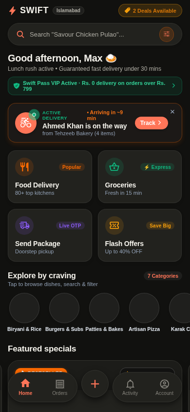
*Home — marketplace launchpad with search, Swift Pass banner, live delivery card, and category shortcuts.*

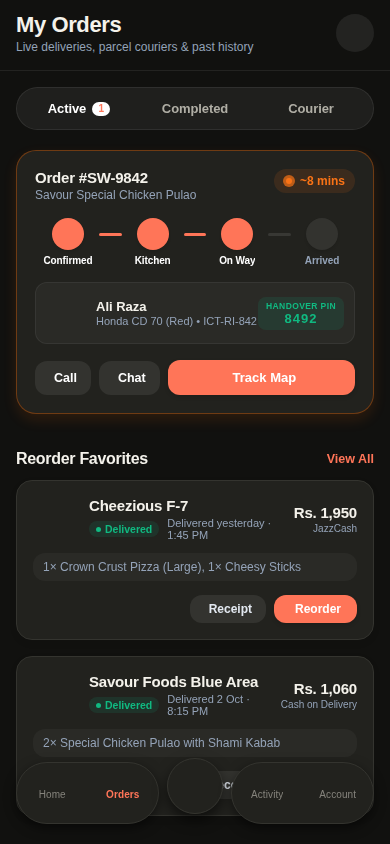
*Orders — active, completed, and courier order history.*

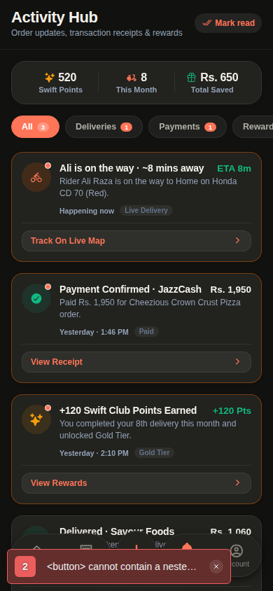
*Activity — order updates, transaction receipts, points, and rewards.*

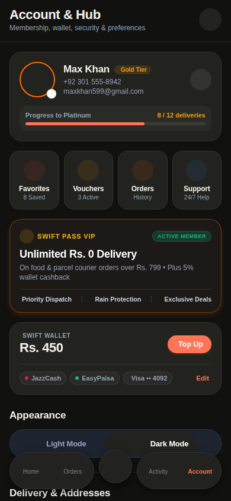
*Account — membership tier, wallet, security, and appearance preferences.*

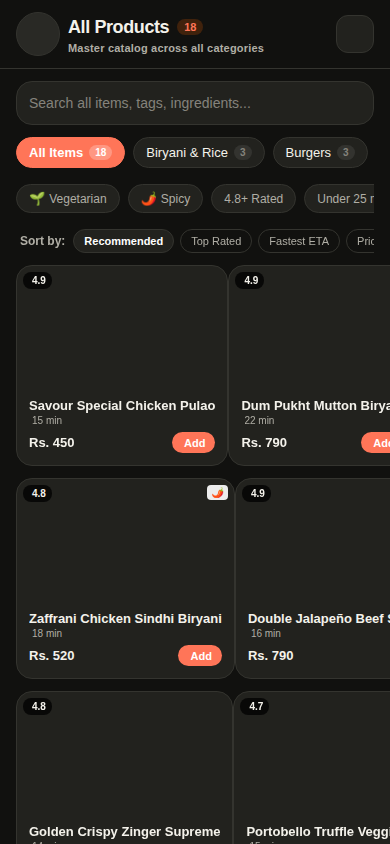
*Products — the full master catalog across all categories.*

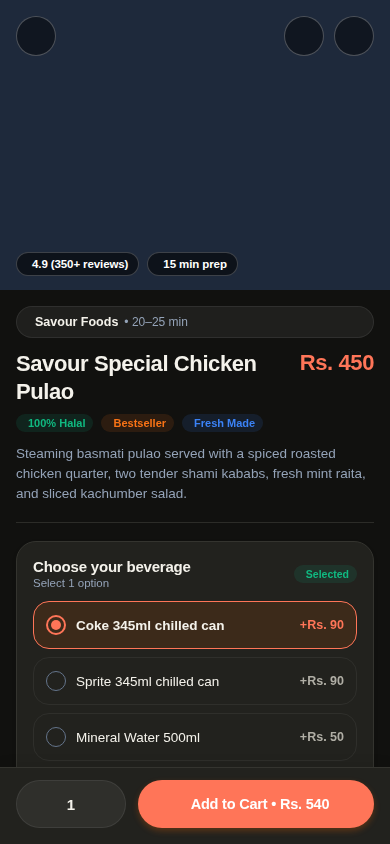
*Product detail — Savour Special Chicken Pulao with ratings, modifiers, and pricing.*

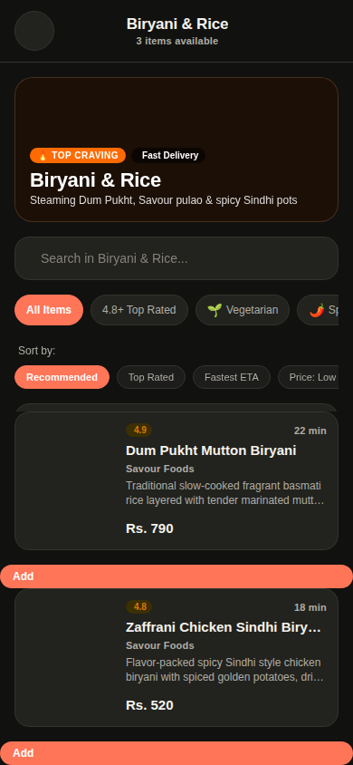
*Category — Biryani & Rice explorer with search, filters, and quick add.*

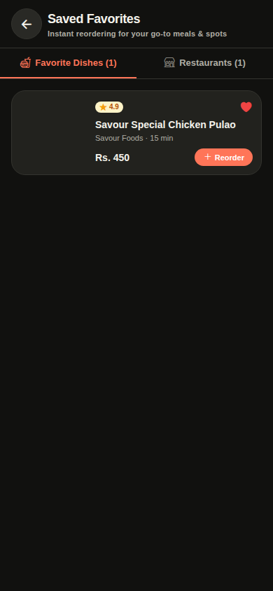
*Favorites — saved dishes and restaurants for instant reordering.*

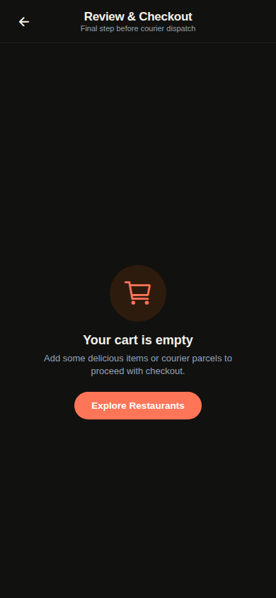
*Checkout — review and confirmation step (shown with an empty cart).*

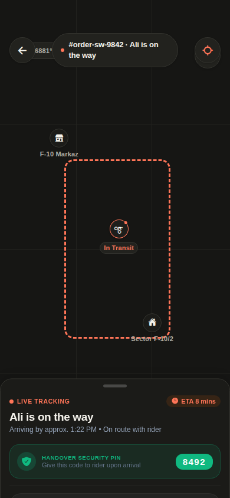
*Tracking — live courier tracking for demo order `order-sw-9842` with ETA and handover PIN.*

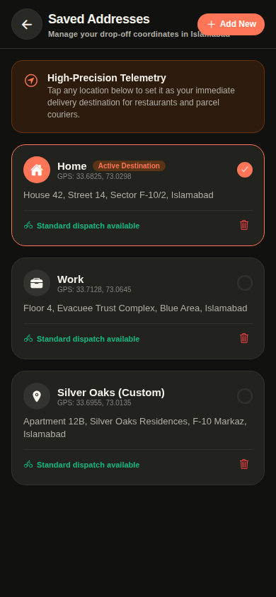
*Addresses — saved drop-off locations in Islamabad.*

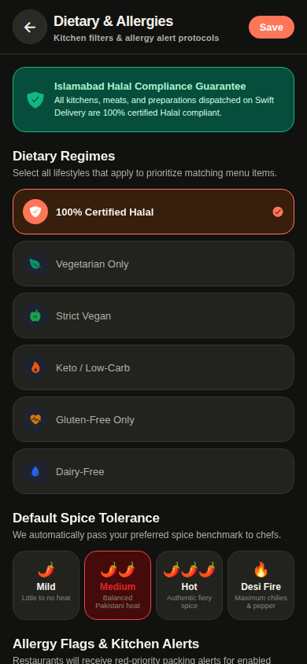
*Dietary — kitchen filters and allergy alert preferences.*

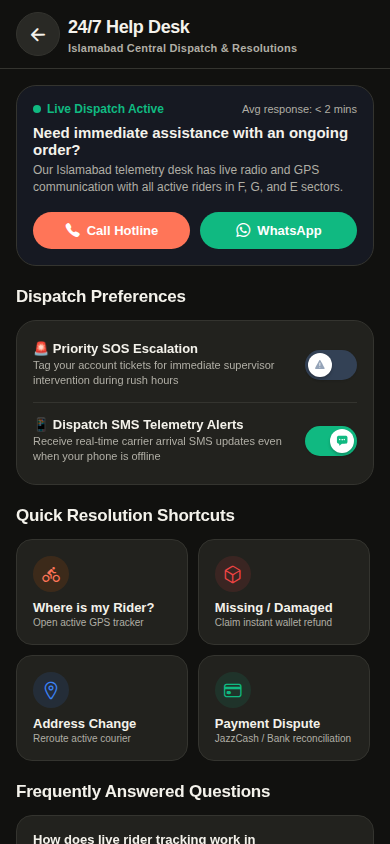
*Support — 24/7 help desk with live dispatch status.*

---

## 🛠 Tech Stack

| Layer | Tool / Library |
|---|---|
| Framework | **Expo SDK 57** (Managed Workflow) with **Expo Router** |
| Language | **TypeScript** (Strict mode) |
| UI Primitives | Pure React Native (`View`, `Text`, `Pressable`, `FlatList`, `ScrollView`, `SafeAreaView`) |
| Gestures | **react-native-gesture-handler** (Swipe-to-order, pan gesture) |
| Animations | **react-native-reanimated** (60fps native animations) |
| Bottom Sheet | **@gorhom/bottom-sheet** (3 snap points) |
| Map & Courier Tracking | **@maplibre/maplibre-react-native** (OpenFreeMap vector tiles, no API key needed) |
| Haptics | **expo-haptics** |
| State Management | **Zustand** + **AsyncStorage** |
| Backend (Optional) | **@supabase/supabase-js** (Realtime subscriptions) |
| Build System | **EAS Build** (preview APK profile) |

---

## 📁 Project Structure

```text
swift-courier-react-native/
├── app/                        # Expo Router file-based routes
│   ├── _layout.tsx             # Root layout with GestureHandlerRootView & SafeArea
│   ├── index.tsx               # Redirect to the tab navigator
│   ├── (tabs)/
│   │   ├── index.tsx           # Home marketplace screen (search, categories, cart pill)
│   │   ├── orders.tsx          # Order history screen
│   │   ├── activity.tsx        # Activity hub (updates, receipts, rewards)
│   │   └── account.tsx         # Account & settings screen
│   ├── products.tsx            # Master catalog screen
│   ├── product/
│   │   └── [productId].tsx     # Product details & modifier customization
│   ├── category/
│   │   └── [categoryKey].tsx   # Category explorer with search & filters
│   ├── favorites.tsx           # Saved dishes & restaurants
│   ├── checkout.tsx            # Checkout & order confirmation screen
│   ├── tracking/
│   │   └── [orderId].tsx       # Live delivery tracking screen & simulation
│   ├── addresses.tsx           # Saved drop-off addresses
│   ├── dietary.tsx             # Dietary & allergy preferences
│   └── support.tsx             # Help desk screen
│
├── components/
│   └── ui/                     # Pure React Native UI components
│       ├── Screen.tsx          # Themed SafeAreaView container
│       ├── AppText.tsx         # Typography wrapper
│       ├── PrimaryButton.tsx   # Themed interactive button
│       ├── ThemeToggle.tsx     # Light/Dark toggle with haptic feedback
│       ├── LoadingSkeleton.tsx # Shimmer skeleton placeholder
│       └── theme.ts            # Palette & semantic tokens
│
├── data/                       # Static demo datasets
│   ├── stores.ts               # Demo restaurants and merchants
│   ├── products.ts             # Menu items with add-on modifier groups
│   ├── routeCoordinates.ts     # Realistic Islamabad transit waypoints
│   └── demoOrder.ts            # Pre-seeded active order
│
├── hooks/
│   └── useTheme.ts             # Theme hook
│
├── lib/
│   ├── currency.ts             # PKR / Rs. formatting
│   ├── orderStatus.ts          # Order lifecycle stages & labels
│   ├── map.ts                  # Bearing, distance, coordinate math
│   └── supabase.ts             # Safe optional Supabase client
│
├── store/
│   ├── cart.store.ts           # Cart state + AsyncStorage persistence
│   ├── order.store.ts          # Active order & courier coordinates
│   ├── theme.store.ts          # Persisted light/dark mode preference
│   └── demo.store.ts           # Demo simulation controls
│
├── types/
│   ├── cart.ts
│   ├── order.ts
│   ├── product.ts
│   └── store.ts
│
├── app.json                    # Expo project & Android configuration
├── babel.config.js             # Babel setup with Reanimated plugin
├── eas.json                    # EAS preview APK configuration
└── package.json
```

---

## 🚀 Getting Started

### 1. Install Dependencies

Using `npx expo install` ensures versions compatible with Expo SDK 57:

```bash
npm install
```

Or install the exact native modules with Expo CLI:

```bash
npx expo install expo-router react-native-safe-area-context react-native-screens react-native-gesture-handler react-native-reanimated @gorhom/bottom-sheet @maplibre/maplibre-react-native expo-haptics expo-image zustand @react-native-async-storage/async-storage @supabase/supabase-js expo-status-bar expo-constants @expo/vector-icons
```

### 2. Environment Variables (Optional)

Copy `.env.example` to `.env`:

```bash
cp .env.example .env
```

Configure:
- `EXPO_PUBLIC_SUPABASE_URL` & `EXPO_PUBLIC_SUPABASE_ANON_KEY`: (Optional) Supabase credentials for real-time remote sync. If omitted, the app runs smoothly with the offline simulation engine.
- *Maps Note*: Uses **MapLibre** with **OpenFreeMap** tiles (`https://tiles.openfreemap.org/styles/liberty`) — 100% free, no API key or billing required.

### 3. Start the Development Server

```bash
npx expo start
```

- Press **`a`** to open on an Android Emulator or connected physical Android device.
- Scan the QR code using the **Expo Go** app on your phone.

---

## 🤖 Running Android Locally

To generate the native Android project files and build locally with Android Studio:

```bash
npx expo run:android
```

*(Ensure Android Studio and Android SDK are installed with `ANDROID_HOME` configured).*

---

## 📦 Building an Installable Android APK with EAS

To generate a standalone APK that clients can download and install directly on Android phones (without needing Expo Go or Google Play Store):

1. **Install EAS CLI**:
   ```bash
   npm install -g eas-cli
   ```

2. **Log in to your Expo account**:
   ```bash
   eas login
   ```

3. **Configure the project with EAS**:
   ```bash
   eas build:configure
   ```

4. **Trigger the preview APK build**:
   ```bash
   eas build --platform android --profile preview
   ```

EAS will build the APK in the cloud using the `preview` profile defined in `eas.json` (`android.buildType: "apk"`). Once complete, you will receive a direct link and QR code to download and install the APK on any Android device.
